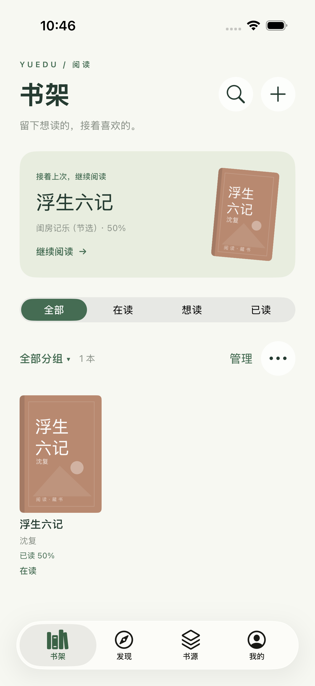

# 阅读 · Yuedu

一个以中文网文阅读为主要方向、使用 Swift + UIKit 编写的 iPhone 阅读应用，参考 [Legado](https://github.com/gedoor/legado) 的书架与自定义书源理念，独立实现。最低支持 iOS 16，也提供 iPad 基础布局。没有第三方依赖。



## 打开与运行

1. 用 Xcode 打开 `Yuedu.xcodeproj`，选择 `Yuedu` scheme。
2. 选择 iPhone 模拟器，点击 Run。首次启动为空书架，可搜索书源或导入自己的书；书架的「＋」菜单保留一个公版节选的离线试读入口。
3. 真机运行：在 Signing & Capabilities 中选择你自己的开发团队，连接 iPhone 后运行。新项目使用占位 Bundle ID `com.example.yuedu`，未指定团队或配置发布签名；若你的团队要求唯一 ID，请由你自行设置。

已经提交到工作目录的 Xcode 工程可直接打开，无需安装 XcodeGen。只有更改文件/target 结构时，才需要用 `xcodegen generate` 从 `project.yml` 重新生成工程。

应用使用 UIKit 的 `UIScene` 生命周期，由 `YueduSceneDelegate` 管理主窗口、前后台切换和外部文件打开；`AppDelegate` 保留进程初始化与系统后台下载回调。目前采用单窗口配置。

```sh
xcodebuild -project Yuedu.xcodeproj -scheme Yuedu \
  -destination 'generic/platform=iOS Simulator' \
  -derivedDataPath build/DerivedData CODE_SIGNING_ALLOWED=NO build
```

## 已实现

- **书架**：三列封面、继续阅读、全部/在读/想读/已读筛选、自定义分组、置顶、最近阅读/添加/书名/进度排序；支持批量移组、修改状态、置顶和移除。长按书籍可管理单本书。旧版未读示例书默认收起，可在书架选项中显示，自己的导入书和已读过的示例书保持可见。
- **本地导入**：从系统“文件”导入 TXT 或未加密 EPUB，也可通过系统“打开方式”接收文件。自动识别编码/章节，EPUB 按 spine 顺序阅读。
- **阅读器**：滚动阅读与 UIKit 水平平移翻页，支持左右滑动及左右轻点翻页，跨页/跨章、页码、阅读位置和书签恢复。按实际字体、行距和屏幕尺寸分页，字号/旋转变化时按文字位置重新排版。正文始终按全屏区域排版，上下功能栏位于独立覆盖层，采用随纸张主题变化的独立底色和细分隔线，展示位置保持不变，显隐不会挤压正文或重新分页。上下滑动正文会自动隐藏上下功能栏，轻点正文中央可重新显示或隐藏；工具栏不再单独显示「全屏」按钮。可选择全屏时显示状态栏，文字颜色随主题调整，横竖屏正文避开安全区域。功能栏仅保留翻章与阅读操作。正文和底部信息栏属于同一阅读层，信息栏显示：「第几章 · 章节名」及「当前页 / 本章总页数」；功能栏展开时覆盖信息栏，收起后露出，信息栏始终沿用阅读纸张底色；平移模式显示实际分页数，滚动模式按正文视口折算，章末显示最后一页，加载或无正文时显示占位页码。另有纸色/纯白/夜间、亮度和系统语音朗读。目录支持名称/序号搜索、倒序、仅看已缓存和定位当前章节。
- **在线书籍管理**：书籍详情、更新目录、同名书籍换源续读。更新目录会迁移可匹配的进度和书签、保留缓存；无法可靠匹配时保留原数据并说明原因。换源对比作者、目录与末章，支持中文/数字章号匹配、手动选章、章内进度选择和正文试读；试读成功后一次性保存新版本与可匹配书签，保留原版本，并可从「已保存版本」返回。
- **缓存管理**：在「我的」查看在线书籍正文大小、章节覆盖与下载任务，支持搜索、状态筛选、大小排序和多书批量缓存/暂停/清理。单本可全书、后续 50 章、指定范围或多选章节缓存，支持暂停后按原范围继续、仅重试失败章节和取消任务。可清理选中章节、全书或已读正文；已读清理保留当前章与书签章节。本地书不参与清理，目录、进度、书签和书架设置保留。普通章节支持系统后台下载与前台解析。
- **发现**：按书源展开/收起分类和榜单，内容来自书源的 `exploreUrl`。支持书源名称/分组筛选、分组菜单、刷新分类、全部收起、失败重试和登录入口；点分类进入分页书目，可边加载边打开已显示的书籍；统一进入书籍详情查看目录与试读，已入库书籍直接按原进度续读。只显示已启用、允许发现且配置发现规则的文字书源，书名搜索保留在右上角。
- **书源**：最大 50 MB / 10,000 项 JSON 文件、网址或粘贴导入；支持名称/网址/分组搜索、状态筛选、多选启停、分组、所选导出与删除。书源列表保留一个启用开关，并用文字展示发现状态；通过每行「···」菜单显示或隐藏发现，不影响在线搜索。没有发现规则的书源不显示该菜单项，批量开启/关闭仍保留。可按关键词检测搜索、目录和首章，保留失败阶段、原因与耗时，支持重试。保留完整配置编辑与逐项导入报告，排除漫画、有声和视频等类型。
- **在线搜索**：按书源或分组选定范围，支持书名/作者包含、书名完全匹配及相关度/书名/作者/书源排序；默认合并同名同作者，同一书源多条收录折叠展示；可按需查看目录摘要和首章试读，试读不会加入书架，并记住每个书源选中的收录。搜索范围和近期成功/耗时记录保存在本机，书源规则变更后旧耗时失效。最多并行 4 个书源，普通请求预算 12 秒、失败重试 30 秒；先搜索最多 12 个优先书源，可分批扩大搜索。结果按稳定位置增量更新，滚动时延后刷新。停止保留结果，继续时先恢复未完成请求。最近 20 次关键词仅保存在本机，可再次搜索或清空；从书架搜索转到在线搜索会带上关键词。
- **字体与排版**：阅读设置中进入「字体与排版」，可选本机可用的宋体、系统黑体、楷体及系统字体库中的字体，支持加粗、14–36 pt 字号、行距、段距、字距、首行两字缩进、左/两端对齐、标题居中及上下左右留白。提供可滚动的实时预览、舒适/紧凑/大字预设和恢复默认；滚动与平移分页共用设置，重启保留，字体不可用时自动回退。恢复默认排版保留主题、翻页和全屏偏好。
- **正文净化**：在阅读设置或「我的」管理普通/正则替换，限定所有书籍、本书或书源，支持启停、排序、编辑、删除与 JSON 导入导出。可预览原文/结果及命中次数；提供零宽空格、多余空行、重复章名规则。滚动阅读、平移翻页和听书使用同一结果，缓存保留原文，支持全局或单书恢复原文。规则不默认删除疑似广告。
- **文字书源引擎**：CSS / XPath / JSONPath、JavaScript、变量与组合规则、索引和正则替换；GET / POST、GBK 等编码、动态请求头、Cookie、登录设置、发现分类，以及目录和正文分页。在线章节首次读取后缓存为独立正文文件。
- **我的**：本地阅读时间/天数、藏书数量、跨书籍书签、阅读设置和书架备份恢复。

## 书籍管理与备份

书架的「追更管理」集中显示在线连载更新，书架选项里也有入口。支持追更中/有更新/检查失败/已暂停筛选，展示最新章节、未读更新数、检查时间及失败原因。下拉书架或轻点「检查更新」批量获取目录，也可重试失败书籍；书架增加最近更新排序。

新加入的在线书籍默认追更；标为已读的书默认不检查，手动开启可覆盖默认值。本地书不参与追更。长按封面或多选后可开始/暂停追更，详情页也能单独切换。检查只加载书籍信息与目录，不自动下载全部正文。新增章节累计为未读更新，重复检查不重复计数；阅读越过该章或进度达到章末时消除标记，也可手动清除标记而不改变阅读进度。追更状态和更新标记随书架备份。

自动检查默认关闭，开启后在打开应用或返回前台触发，同一本书至少间隔 30 分钟。切入后台会停止本轮检查，已经完成的更新保留；当前不提供后台定时追更或系统推送通知。每次按顺序检查，单本失败不影响其余书；书源停用、移除及目录无法匹配时保留原数据。

书架的「全部分组 → 管理分组」可以新建、重命名和删除分组。删除分组会把书籍移到「未分组」，不删除正文或阅读记录。每本书属于一个分组，阅读状态独立于分组；开始阅读后从「想读」转为「在读」，手动标记「已读」不会改写实际阅读进度。

长按封面管理单本书；点击「管理」进入多选，可全选当前筛选结果，批量移组、设置状态、置顶或移除。切换筛选会清空选择；移除需要确认。排序偏好会保存，置顶始终优先。分组、置顶和状态随书架一起备份；恢复时同名分组合并，现有书籍的管理设置保留。

阅读页右上角的 `…`，或书架封面的长按菜单，可以打开「书籍详情」。在线书籍在这里更新目录、缓存全书或换源。换源搜索其他已启用的文字书源，按同名书籍筛选；在「换源对比」核对作者、目录、末章和续读位置，试读成功后才能确认。书名或作者不一致、作者不明时另行确认；不能唯一匹配章节时手动选择。新版本继承书架分组、状态、置顶和追更开关，可复制准确匹配的书签；已在书架的版本保留自己的设置。原书数据保留，书籍详情的「已保存版本」可返回原进度或离线缓存。章节载入失败时也可直接进入换源。

阅读到章末附近时，可自动预取下一章；只预取一章，与已有缓存任务和前台章节请求去重，离开阅读页或进入后台取消。可在「阅读设置 → 章末预读下一章」关闭。

应用界面支持系统深色外观，选择夜读纸张后设置、目录和书架也使用深色；界面文字跟随系统字号，阅读正文仍由独立排版设置控制。

阅读页「设置 → 翻页方式 → 平移翻页」切换为水平平移分页；轻点左右区域或滑动翻页，章末继续向前会打开下一章。切回「上下滚动」时保留相对阅读位置。

后台下载采用系统 `URLSession` 下载会话，支持无需脚本求值的普通 GET 章节及静态常规请求头。包含动态 URL/请求头、POST 选项、登录 Cookie/认证头、脚本库、网页渲染、源限速等请求，继续使用原前台运行时。多页正文的后续页面也在前台解析时获取，不会为后台下载而忽略书源规则。界面区分传输与待解析；返回应用后自动处理已落盘的页面。

后台调度由 iOS 决定；系统暂停/恢复应用时会重连同一下载会话。从多任务界面强制退出会中止系统任务，重新打开后恢复未完成队列。主动暂停或停用/删除书源会停止传输并保留原任务范围，重启后等待手动继续；移除书籍、取消任务或清理缓存会移除相关任务。后台中断的活动任务仍会自动恢复，已完成正文自动跳过。单个响应最多 8 MB，单本正文最多 100 MB，待解析文件最多 200 MB；达到暂存限额后等待前台处理释放空间。验证这些行为时应使用 Xcode 正常签名的模拟器构建，禁用签名可能导致系统下载服务拒绝连接。

「我的 → 备份与恢复」可以把书架导出为 JSON 文件，包含书籍、已缓存正文、进度、书签和阅读统计（最大 200 MB）。恢复前预览数量，再合并缺少的书籍和可匹配书签；现有书籍的进度与正文保持不变，阅读时长取较大值，日期合并去重。无法对应现有目录的旧书签不覆盖当前数据，原备份仍保留。

书源配置使用同页的「导出书源配置」单独保存。换设备时先在书源页导入配置，再恢复书架，恢复会按书源网址关联设备上的书源。登录状态、Cookie、阅读偏好不包含在书架备份中；尚未导入书源时，已备份的正文仍可离线阅读。备份不会自动上传到云端。

数据保存在设备 Application Support/Yuedu 目录，阅读偏好保存在 UserDefaults。无需登录。书架与书源采用原子文件写入；读取失败会保留原文件并显示错误。阅读进度和时长使用独立的小型检查点，不随每次滚动重写整份目录；结构性修改后通过存储代次防止旧检查点覆盖新目录。保存失败时保留本次运行中的待保存位置，阅读页显示重试入口。

## 书源示例

详细格式、规则边界和例子见 [docs/SOURCES.md](docs/SOURCES.md)。应用不预置外部书源。

批量导入会跳过缺少名称等无效条目，排除非文字类型，并保留文字源的原始规则、脚本和扩展字段。配置结构有问题的文字源会保存并停用，报告具体原因。文件级错误、超限或提交前取消不会部分写入。**导入本身不执行书源脚本；搜索、阅读、发现或登录时会执行相应规则。**

针对本次提供的 391 项合集，离线分类为 **342 个文字源、49 个非文字源**。这表示配置保留范围，不代表 342 个网站已经逐一完成搜索、登录和阅读验证。

验证网络完整流程可在本项目根目录运行：

```sh
python3 scripts/demo_source_server.py
```

然后在 **iPhone 模拟器**的书源页点击 `＋ → 从网址导入`，输入 `http://localhost:8080/source.json`。到发现页点击右上角“搜索书籍”，搜索“春日”，加入《春日手记》并阅读两章。服务仅监听本机回环地址，供模拟器开发验证使用；iPhone 真机的 localhost 指向手机自身。

`Yuedu/Resources/example-source.json` 是默认停用的配置示例；本地服务 `/source.json` 会将它改为启用后返回。

## 范围与后续

这是独立实现的原生阅读应用，并非 Legado 全功能移植。规则运行在独立的 WebKit 环境中；其页面不能自行联网或导航，网络操作经受限宿主接口交给 URLSession 或独立浏览器处理。加解密、字符编码、字体与图像工具使用系统框架，并提供合集所需的一组 Java / Android API 适配，不开放任意 Java 类、Android API 或反射。

为支持用户定义的 HTTP 书源，工程设置了 `NSAllowsArbitraryLoads`；HTTPS 仍使用系统 TLS 证书验证。登录、验证码和网页验证从「登录与设置」入口由用户完成。应用不会自动执行付费购买规则。

静态语法支持不等于网站可用，也不承诺完整兼容所有 Legado 书源。真实字体混淆站点、动态下载的远端脚本库尚未完成实站验证；网站变更、账号权限和验证机制仍可能导致失败。具体能力和限制见 [书源文档](docs/SOURCES.md)。

尚未实现云同步、PDF 阅读。漫画、有声、视频源不纳入文字源库；有 DRM 的 EPUB 不支持。EPUB 以纯文本呈现，暂不保留图片与复杂排版。朗读在阅读页内运行，切到后台后停止。换源支持唯一章节名及中文/数字章号加标题的匹配；仅章号相同、重复标题或拆章/合章等情况需手动定位。章内进度与书签按比例迁移，不保证不同排版下的逐字位置。

## 验证

项目包含导入与异常文件、合集筛选与原始字段保留、规则解释、脚本宿主、HTTP、系统加解密工具、持久化和阅读器测试，以及本地书源的界面流程测试。具体执行结果以 [docs/VALIDATION.md](docs/VALIDATION.md) 中对应阶段的记录为准。

另有本地测试书源端到端 UI 测试，运行前启动上述本地服务。覆盖导入、搜索、目录更新、缓存、换源、后台传输和返回前台的离线解析；不代表外部站点已通过验证。平移翻页用内置经典节选检查跨章、主题、字号、旋转和重启恢复。

```sh
scripts/yuedu_test.sh
```

测试脚本默认创建或复用专用的 `Yuedu Experience Tests` 模拟器，避免测试重置影响日常书库；也可通过 `YUEDU_TEST_DEVICE_ID` 指定专用测试设备。可传入 `-only-testing:YueduTests` 等筛选参数。编译缓存统一复用 `build/validation/DerivedData`，日志和结果放入 `build/validation/runs`；每轮结束保留最近两轮，超过七天的旧轮次清理，但始终保留最新一轮和正在运行的轮次。`python3 scripts/yuedu_clean_artifacts.py` 可预览清理范围，添加 `--apply` 执行。脚本只清理带管理标记的测试目录，保留书源样本、文档截图和源码。

以上命令用于复现验证，不代表已经在所有 iOS 版本或实体设备上执行。
